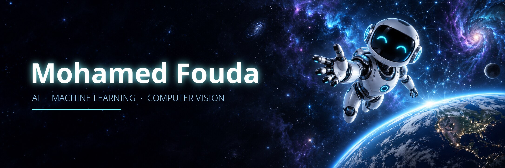

  

<h1 align="center">Hi, I'm Mohamed Adel Fouda 👋</h1>

  

<h3 align="center">AI & Machine Learning · Computer Vision · Medical Imaging</h3>

  
  
  

---

### 🧠 About me
I build AI systems that go from a trained model to a working deployment. My work centers on deep learning for computer vision and medical imaging, plus applied NLP and retrieval systems.

### 🔭 What I've been working on
- 🦷 **Oskar Cephalo v2**: AI-powered cephalometric landmark detection and CVM classification, with a deployable API
- 🩻 **Oskar Panorama AI**: dental panoramic image analysis deployment
- 🧬 **DILI prediction**: drug-induced liver injury models from SMILES, protein targets, gene expression and clinical biomarkers
- 🏥 **Pyramedx Clinical RAG**: retrieval-augmented generation for clinical content
- 🛍️ **Shoplifting Detection System**: real-time detection from security footage with pose estimation and anomaly detection

### 🛠️ Tech stack

  
  
  
  
  
  
  

### 📊 GitHub stats

  
  

  

### 🏆 Trophies

  

### 📈 Contribution activity

  

### 🐍 Contribution snake

  <picture>
    <source media="(prefers-color-scheme: dark)" srcset="https://raw.githubusercontent.com/M12803/M12803/output/github-snake-dark.svg">
    <source media="(prefers-color-scheme: light)" srcset="https://raw.githubusercontent.com/M12803/M12803/output/github-snake.svg">
    
  </picture>

---

  

