  

  

  
  
  

---

## 🛰️ Mission brief

I build AI systems that travel the whole distance from a trained model to a working product. My focus is deep learning for **computer vision and medical imaging**, plus applied **LLM agents and retrieval (RAG)**. I am the founder of **PyramedX**, an AI and software company based in Egypt.

| | |
|---|---|
| 🚀 **Role** | AI Engineer, Founder of PyramedX |
| 🔭 **Focus** | Computer vision, medical imaging, LLM agents, RAG |
| 🌍 **Base** | Egypt |
| 📡 **Open to** | AI and software projects, collaborations, clinical-AI work |

---

## 🪐 Featured missions

| Mission | What it does | Stack |
|---|---|---|
| [**Oskar Cephalo v2**](https://github.com/M12803/Oskar-Cephalometric-v2-deployment) | Cephalometric landmark detection and CVM classification with a deployable API | Python, ONNX, FastAPI, Gradio |
| [**ToothTruth / Oskar Panorama**](https://github.com/M12803/Oskar-Panorama-AI---Deployment) | Dental panoramic radiograph analysis with an API and dashboard | PyTorch, FastAPI, Streamlit |
| [**Pyramedx Clinical RAG**](https://github.com/M12803/Pyramedx-Clinical-RAG) | Evidence-grounded clinical assistant with cited answers and safety guardrails | Python, BGE-M3, BM25, React |
| [**PYRAMEDX AI Marketing**](https://github.com/M12803/pyramedx-AI-MARKETING) | From marketing idea to ready-to-use campaign in one conversation | TanStack Start, React 19, Tailwind |
| [**Dr.Liver**](https://github.com/M12803/dr-liver) | Multi-modal deep learning for drug-induced liver injury (DILI) prediction | PyTorch, RDKit, Jupyter |
| [**MR Barber**](https://github.com/M12803/MR-barber-Project) | Offline-first barbershop management system, bilingual | React, TypeScript |
| [**Shoplifting Detection**](https://github.com/M12803/Shoplifting-Detection-System) | Real-time detection from security footage with pose and anomaly models | OpenCV, Deep Learning |

---

## 🧰 Tech stack

  
  
  
  
  
  
  
  
  
  
  

---

## 📊 Telemetry

  
  

  

  

  <picture>
    <source media="(prefers-color-scheme: dark)" srcset="https://raw.githubusercontent.com/M12803/M12803/output/github-snake-dark.svg">
    <source media="(prefers-color-scheme: light)" srcset="https://raw.githubusercontent.com/M12803/M12803/output/github-snake.svg">
    
  </picture>

---

## 📡 Contact

Open to AI and software work. Reach me on [LinkedIn](https://linkedin.com/in/mohamed-adel-1ab81528a).

  

